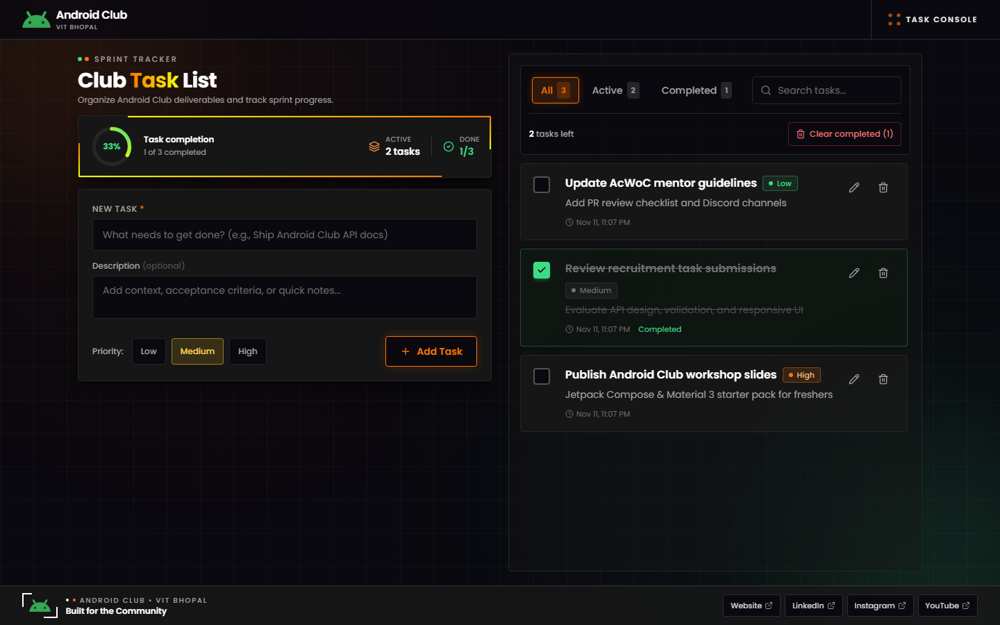
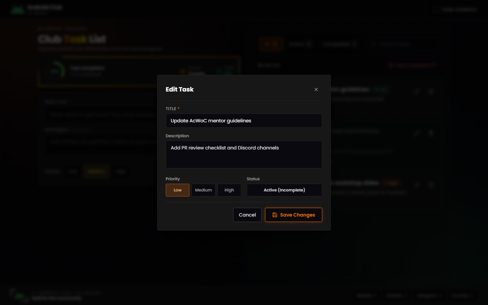
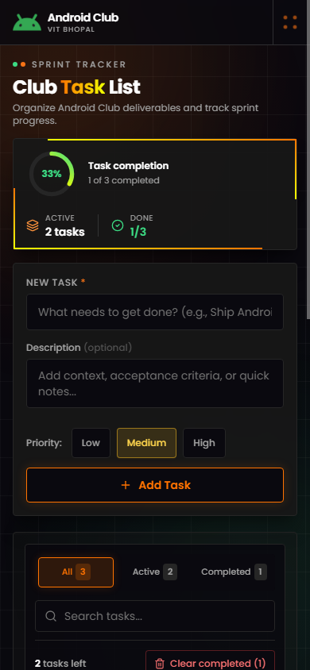

# Android Club Task List

A full-stack Task List web application built with React (Vite + Tailwind CSS), Node.js + Express, and MongoDB. Styled with the dark obsidian, neon orange , and Android green visual identity of [androidclub.tech](https://androidclub.tech).

---

## Live Deployment

| Service | Platform | URL |
| --- | --- | --- |
| **Frontend App** | Netlify | [https://sprint-tracker-task-app.netlify.app/](https://sprint-tracker-task-app.netlify.app/) |
| **Backend REST API** | Render | [https://sprint-tracker-api-zism.onrender.com/api](https://sprint-tracker-api-zism.onrender.com/api) |
| **API Health Check** | Render | [https://sprint-tracker-api-zism.onrender.com/api/health](https://sprint-tracker-api-zism.onrender.com/api/health) |

> See [Deployment Guide](#8-deployment-guide) below for step-by-step instructions for deploying on Render, MongoDB Atlas, and Netlify.

---

## 1. Features

- **Add Tasks:** Create a task with a title (required, max 120 chars), optional description (max 500 chars), and priority (`Low`, `Medium`, `High`).
- **Edit Tasks:** Update task title, description, priority, or completion status inside an accessible edit modal.
- **Delete with Confirmation:** Confirm before deleting a single task or clearing all completed tasks.
- **Toggle Completion:** Mark tasks as complete or active with live progress updates.
- **Circular Progress Tracker:** Real-time SVG completion percentage ring alongside remaining and completed counts.
- **Filter & Search:** Switch between `All`, `Active`, and `Completed` tabs, search by keyword, and view `"X tasks left"`.
- **Database Persistence:** All tasks are stored in MongoDB with automatic `createdAt` and `updatedAt` timestamps.
- **Responsive Design:** Two-column no-scroll desktop workspace (`1024px`–`1440px+`) that adapts cleanly to tablet and mobile (`360px`+).

---

## 2. Tech Stack

| Layer | Technology |
| --- | --- |
| **Frontend** | React 18, Vite, Tailwind CSS, Axios, Lucide React, Poppins Font |
| **Backend** | Node.js, Express 4, CORS, dotenv |
| **Database** | MongoDB (Mongoose 8) |
| **Testing** | Node Test Runner (`node --test`), `mongodb-memory-server` |

---

## 3. Screenshots

Saved in [`docs/screenshots/`](./docs/screenshots/):

### Desktop View (`1440×900`)


### Edit Task Modal


### Mobile View (`390×844`)


---

## 4. Folder Structure

```text
task-list-app/
├── backend/
│   ├── config/
│   │   └── db.js                   # MongoDB connection helper
│   ├── controllers/
│   │   └── taskController.js       # CRUD logic and input validation
│   ├── middleware/
│   │   ├── errorHandler.js         # AppError, 404 handler, centralized error formatter
│   │   └── validateObjectId.js     # Checks :id param is a valid MongoDB ObjectId
│   ├── models/
│   │   └── Task.js                 # Mongoose Task schema
│   ├── routes/
│   │   └── taskRoutes.js           # Express API routes
│   ├── scripts/
│   │   └── devMemory.js            # Starts backend with an in-memory MongoDB for quick local runs
│   ├── tests/
│   │   └── tasks.test.js           # Automated API integration tests
│   ├── .env.example
│   ├── package.json
│   └── server.js                   # Express app setup and server entrypoint
├── frontend/
│   ├── public/
│   │   └── Logo.png                # Android Club logo
│   ├── src/
│   │   ├── components/
│   │   │   ├── ConfirmModal.jsx
│   │   │   ├── EditTaskModal.jsx
│   │   │   ├── FilterBar.jsx
│   │   │   ├── Footer.jsx
│   │   │   ├── Header.jsx
│   │   │   ├── Navbar.jsx
│   │   │   ├── TaskForm.jsx
│   │   │   ├── TaskItem.jsx
│   │   │   ├── TaskList.jsx
│   │   │   └── Toast.jsx
│   │   ├── hooks/
│   │   │   ├── useTasks.js
│   │   │   └── useToast.js
│   │   ├── services/
│   │   │   ├── api.js
│   │   │   └── taskService.js
│   │   ├── App.jsx
│   │   ├── index.css
│   │   └── main.jsx
│   ├── .env.example
│   ├── index.html
│   ├── package.json
│   ├── postcss.config.js
│   ├── tailwind.config.js
│   └── vite.config.js
├── docs/
│   ├── postman_collection.json     # Ready-to-import Postman collection
│   └── screenshots/
│       ├── desktop.png
│       ├── edit-modal.png
│       └── mobile.png
├── .gitignore
└── README.md
```

---

## 5. Simple Setup Guide (Run Locally)

### What You Need First
- **Node.js** (version 18 or newer) — comes with `npm`
- **A MongoDB Atlas account** *(only needed if you want tasks saved permanently across restarts; you can also run it in seconds without any database setup using Option A below)*

### Step 1: Open the Project
Clone or download the repository, then open a terminal inside the project folder:
```bash
cd task-list-app
```

### Step 2: Start the Backend Server

Open a terminal in the `backend` folder and install packages:
```bash
cd backend
npm install
```

Choose **one** of the two ways to run the backend:

- **Option A — Quick Start (No database setup needed):**
  Starts the API with a built-in temporary MongoDB database so you can test the app right away:
  ```bash
  npm run dev:memory
  ```

- **Option B — Persistent Database (MongoDB Atlas / Local MongoDB):**
  1. Copy `.env.example` to `.env`:
     ```bash
     cp .env.example .env
     ```
     *(On Windows Command Prompt, use `copy .env.example .env`.)*
  2. Open `backend/.env` and paste your MongoDB connection string into `MONGODB_URI`.
  3. Start the server:
     ```bash
     npm run dev
     ```

You should see the backend running at **`http://localhost:5000`**.

### Step 3: Start the Frontend App

Open a **second terminal**, go to the `frontend` folder, install packages, and start Vite:
```bash
cd frontend
npm install
cp .env.example .env
npm run dev
```

### Step 4: Open in Your Browser
Visit **`http://localhost:5173`**. You can now add, edit, complete, search, filter, and delete tasks.

### Running Backend Tests
From the `backend` folder:
```bash
npm test
```
This runs the integration test suite against an isolated in-memory MongoDB instance.

---

## 6. Environment Variables

### Backend (`backend/.env`)

| Variable | Required | Default | Description |
| --- | --- | --- | --- |
| `PORT` | No | `5000` | Port for the Express server |
| `NODE_ENV` | No | `development` | Environment mode (`development`, `production`, `test`) |
| `MONGODB_URI` | **Yes** *(for `npm start` / `npm run dev`)* | — | MongoDB Atlas or local MongoDB URI |
| `CORS_ORIGIN` | No | `http://localhost:5173` | Allowed frontend origin(s), comma-separated |

### Frontend (`frontend/.env`)

| Variable | Required | Default | Description |
| --- | --- | --- | --- |
| `VITE_API_URL` | No | `http://localhost:5000/api` | Base URL of the backend REST API |

---

## 7. API Reference

Every endpoint returns JSON in a consistent structure:
```json
{
  "success": true,
  "data": {},
  "message": "Human-readable status message"
}
```

A Postman v2.1 collection is included at [`docs/postman_collection.json`](./docs/postman_collection.json).

| Method | Endpoint | Description | Status Codes |
| --- | --- | --- | --- |
| `GET` | `/api/health` | Check API server status | `200` |
| `GET` | `/api/tasks` | List all tasks (supports `?status=all\|active\|completed`, `?priority=low\|medium\|high`, `?search=...`) | `200`, `400` |
| `GET` | `/api/tasks/:id` | Get a single task by ID | `200`, `400`, `404` |
| `POST` | `/api/tasks` | Create a new task | `201`, `400` |
| `PUT` | `/api/tasks/:id` | Update a task (`title`, `description`, `completed`, `priority`) | `200`, `400`, `404` |
| `PATCH` | `/api/tasks/:id/toggle` | Toggle `completed` status | `200`, `400`, `404` |
| `DELETE` | `/api/tasks/:id` | Delete a single task | `200`, `400`, `404` |
| `DELETE` | `/api/tasks/completed` | Delete all completed tasks | `200` |

### Example Request & Response (`POST /api/tasks`)

**Request Body:**
```json
{
  "title": "Prepare Android Club workshop slides",
  "description": "Cover Jetpack Compose state management",
  "priority": "high"
}
```

**Response (`201 Created`):**
```json
{
  "success": true,
  "data": {
    "_id": "6731a9c4e1b2c3d4e5f60002",
    "title": "Prepare Android Club workshop slides",
    "description": "Cover Jetpack Compose state management",
    "completed": false,
    "priority": "high",
    "createdAt": "2026-11-11T16:25:00.000Z",
    "updatedAt": "2026-11-11T16:25:00.000Z"
  },
  "message": "Task created successfully"
}
```

### Quick `curl` Examples

```bash
# Create a task
curl -X POST http://localhost:5000/api/tasks \
  -H "Content-Type: application/json" \
  -d '{"title":"Review PR #42","description":"Check error handling","priority":"high"}'

# List all tasks
curl http://localhost:5000/api/tasks

# Toggle completion
curl -X PATCH http://localhost:5000/api/tasks/<TASK_ID>/toggle

# Delete a task
curl -X DELETE http://localhost:5000/api/tasks/<TASK_ID>
```

---

## 8. Deployment Guide

### Backend on Render + MongoDB Atlas
1. Create a free MongoDB Atlas cluster, add a database user, allow network access (`0.0.0.0/0` for Render), and copy the connection string.
2. Create a new Render Web Service connected to this repository with **Root Directory** set to `backend`.
3. **Build Command:** `npm install`
4. **Start Command:** `npm start`
5. Add environment variables:
   - `NODE_ENV=production`
   - `MONGODB_URI=<your-mongodb-atlas-uri>`
   - `CORS_ORIGIN=https://<your-netlify-site>.netlify.app`
6. Confirm `GET /api/health` returns `200 OK`.

### Frontend on Netlify
1. Import the repository into Netlify and set **Base directory** to `frontend`.
2. **Build command:** `npm run build` | **Publish directory:** `frontend/dist`
3. Add environment variable:
   - `VITE_API_URL=https://<your-render-service>.onrender.com/api`
4. Trigger a deploy and ensure `CORS_ORIGIN` on Render matches your Netlify URL (without a trailing slash).

---

## 9. Future Improvements

- User accounts and authentication so each member has a private task list.
- Optional due dates with overdue indicators and sorting.
- Drag-and-drop task ordering persisted in MongoDB.
- Category tags for club tracks (Android, Web, Design, Events).
